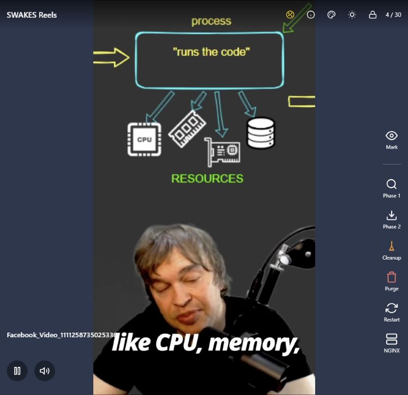
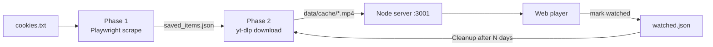

<p align="center">
  
</p>

<h1 align="center">FBReelz</h1>

<p align="center">
  Pull the videos you saved on Facebook down to your own server and swipe through them in a self-hosted, full-screen player.
</p>

<p align="center">
  <a href="#quick-start">Quick start</a> ·
  <a href="https://makes.swakes.co.uk/fbreelz/">Blog write-up</a> ·
  <a href="#troubleshooting">Troubleshooting</a>
</p>

<br>

## Contents

- [What it does](#what-it-does)
- [How it works](#how-it-works)
- [Requirements](#requirements)
- [Quick start](#quick-start)
- [Using the player](#using-the-player)
- [Environment variables](#environment-variables)
- [Ports and paths](#ports-and-paths)
- [Command line](#command-line)
- [Troubleshooting](#troubleshooting)
- [Security](#security)
- [Repository layout](#repository-layout)
- [Licence](#licence)

<br>

## What it does

Facebook's **Saved** list is easy to add to and hard to get anything back out of. FBReelz:

- scrolls your Saved page in headless Chromium (Playwright) using your browser cookies and collects every reel and video link
- downloads each one as an MP4 with yt-dlp, skipping videos you have already watched and cleaned up
- serves them in a swipeable, full-screen web player with watched marks, colour themes and an info panel
- deletes watched videos after a set number of days (Cleanup), so the cache doesn't grow forever
- can send a Pushover notification when a download run finishes

<p align="center">
  
</p>

> [!NOTE]
> Full write-up, background and lessons learned: [makes.swakes.co.uk/fbreelz](https://makes.swakes.co.uk/fbreelz/)

<br>

## How it works



Everything runs in one container. Supervisord keeps the Node server running, and the Node server runs the Python phases when you press **Phase 1** or **Phase 2** in the player.

<br>

## Requirements

- Linux host (Ubuntu or Raspberry Pi OS) with Docker and the Compose plugin
- Your Facebook cookies in Netscape `cookies.txt` format, exported with the [cookies.txt Firefox extension](https://github.com/hrdl-github/cookies-txt) while logged in

<br>

## Quick start

**1. Clone the repo**

```bash
git clone https://github.com/pqpxo/FBReelz.git fbreelz
cd fbreelz
```

**2. Set an admin password**

```bash
cp .env.example .env
nano .env                       # set ADMIN_PASSWORD
```

> [!IMPORTANT]
> The admin controls (Phase 1/2, Cleanup, Purge, Cookie Manager) stay locked until `ADMIN_PASSWORD` is set. There is no default password.

**3. Add your cookies**

```bash
mkdir -p data secrets
nano secrets/cookies.txt        # paste the exported cookies
chmod 600 secrets/cookies.txt
```

You can also paste cookies later from the 🍪 Cookie Manager in the player.

**4. Start it**

```bash
docker compose up -d --build
```

Open `http://<server-ip>:3001`, log in, then press **Phase 1** and **Phase 2**.

<br>

## Using the player

| Control | What it does |
| --- | --- |
| Swipe / scroll | Next or previous video |
| **Mark** | Mark the current video as watched. Watched videos are dimmed and don't autoplay |
| **Phase 1** | Scrape your Saved list (up to 30 items) |
| **Phase 2** | Download anything new from the last Phase 1 run |
| **Cleanup** | Delete videos marked watched more than `RETENTION_DAYS` ago. They are not downloaded again |
| **Purge** | Delete every downloaded video. Cannot be undone |
| **Restart** | Restart the Node server inside the container |
| 🍪 | Cookie Manager: see cookie count and age, paste new cookies |
| ⓘ / 🎨 / ☀ | Info panel, colour scheme, light or dark |

Admin buttons ask for the password once. The login lasts until you log out or the container restarts.

<br>

## Environment variables

Set these in `.env`. Docker Compose reads it automatically.

| Variable | Default | Purpose |
| --- | --- | --- |
| `ADMIN_PASSWORD` | none | **Required.** Password for the admin controls |
| `FBREELZ_PORT` | `3001` | Host port for the player |
| `RETENTION_DAYS` | `3` | Days a watched video is kept before Cleanup deletes it |
| `PUSHOVER_USER_KEY` | none | Pushover user key. Leave blank to turn notifications off |
| `PUSHOVER_APP_TOKEN` | none | Pushover application token |
| `TZ` | `Europe/London` | Timezone for logs |

<br>

## Ports and paths

| Item | Where |
| --- | --- |
| Web player and API | host port `FBREELZ_PORT` (default `3001`), plain HTTP |
| Videos, `watched.json`, logs | `./data` → `/app/data` |
| `cookies.txt` | `./secrets` → `/app/secrets` |

`./data` and `./secrets` are bind mounts, so videos, watched marks and cookies survive `docker compose down` and rebuilds.

> [!TIP]
> To reach it from outside your LAN, put it behind a reverse proxy with TLS (Nginx Proxy Manager, Caddy) and point the proxy at port 3001.

<br>

## Command line

```bash
docker exec -it fbreelz python /app/scripts/fbreelz_phase1_playwright.py --max 30
docker exec -it fbreelz python /app/scripts/fbreelz_phase2_resolve.py --download
docker exec -it fbreelz python /app/tests/test_smoke.py
docker compose logs -f
```

Phase 2 also takes `--max N`, `--force` (download again), `--no-filter` (ignore cleaned list), `--no-pushover` and `--fallback-curl`. Logs are written to `data/fbreelz_phase1.log`, `data/fbreelz_phase2.log` and `data/backend.log`.

<br>

## Troubleshooting

| Symptom | Fix |
| --- | --- |
| Phase 1: `Not logged in` or `No video/reel links found` | Cookies have expired. Export them again while logged in and paste them into the Cookie Manager. `data/debug_playwright_saved.html` shows what Playwright saw |
| Phase 2 downloads fail | Facebook changes often. Bump `yt-dlp` in `requirements.txt` and run `docker compose up -d --build` |
| Admin login always says "Invalid password" | `ADMIN_PASSWORD` is empty or wasn't picked up. Set it in `.env`, then `docker compose up -d` |
| Admin buttons send you back to the login | The container restarted, which clears logins. Log in again |
| Container shows `unhealthy` | `docker compose logs fbreelz` and check `data/backend-error.log` |

<br>

## Security

> [!CAUTION]
> `cookies.txt` is a live login to your Facebook account. Anyone who can read it can act as you.

- Keep `secrets/cookies.txt` at `chmod 600`. The Cookie Manager writes it, and its backups, as `600`.
- Admin routes need a login. The password is compared in constant time and sessions are random tokens held in memory.
- The player serves plain HTTP. Keep it on your LAN, or put it behind a reverse proxy with TLS before exposing it.
- Only download content you have the right to keep, and for personal use.

<br>

## Repository layout

```text
.
├── Dockerfile                    # Python + Node + Chromium, supervisord
├── docker-compose.yml
├── .env.example                  # copy to .env
├── fbreelz_phase1_playwright.py  # scrape Saved list
├── fbreelz_phase2_resolve.py     # download with yt-dlp
├── cleaned_videos_filter.py      # skip videos already cleaned up
├── make_cache_playlist.py        # optional: M3U playlist for VLC
├── backend/                      # Node API + cleanup module
├── deploy/                       # server-wrapper.js, supervisord, entrypoint
├── web/                          # player (React, no build step)
└── tests/test_smoke.py
```

<br>

## Licence

No licence file yet. Personal project, provided as is.
