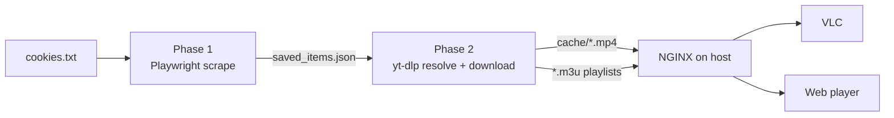

<p align="center">
  
</p>

<h1 align="center">FBReelz</h1>

<p align="center">
  Pull the videos you saved on Facebook down to your own server, then watch them in VLC or a swipeable web player.
</p>

<p align="center">
  <a href="#quick-start">Quick start</a> ·
  <a href="https://makes.swakes.co.uk/fbreelz/">Blog write-up</a> ·
  <a href="#troubleshooting">Troubleshooting</a>
</p>

<br>

## Contents

- [What it does](#what-it-does)
- [How it works](#how-it-works)
- [Requirements](#requirements)
- [Quick start](#quick-start)
- [Serve videos and playlists with NGINX](#serve-videos-and-playlists-with-nginx)
- [Web player (optional)](#web-player-optional)
- [Script reference](#script-reference)
- [Environment variables](#environment-variables)
- [Ports and paths](#ports-and-paths)
- [Run it on a schedule](#run-it-on-a-schedule)
- [Troubleshooting](#troubleshooting)
- [Security](#security)
- [Repository layout](#repository-layout)
- [Licence](#licence)

<br>

## What it does

Facebook's **Saved** list is easy to add to and hard to get anything back out of. FBReelz:

- opens your Saved page in headless Chromium (Playwright) using your browser cookies
- collects the reel and video links it finds
- downloads each one as an MP4 with yt-dlp
- writes M3U playlists you can open in VLC, locally or across your LAN
- lets NGINX serve the MP4s, the playlists and an optional TikTok-style web player

> [!NOTE]
> Full write-up, background and lessons learned: [makes.swakes.co.uk/fbreelz](https://makes.swakes.co.uk/fbreelz/)

<br>

## How it works



The Docker container is a toolbox. It sleeps until you run a phase with `docker exec`. NGINX runs on the host, not in Docker, and serves whatever lands in `./data`.

<br>

## Requirements

- Linux host (Ubuntu or Raspberry Pi OS) with Docker and the Compose plugin
- NGINX on the host
- Your Facebook cookies in Netscape `cookies.txt` format, exported with the [cookies.txt Firefox extension](https://github.com/hrdl-github/cookies-txt) while logged in

<br>

## Quick start

> [!TIP]
> Clone into `/opt/fbreelz`. The NGINX config and the defaults in the scripts all expect that path.

**1. Install prerequisites (Ubuntu)**

```bash
sudo apt update
sudo apt install -y docker.io docker-compose-plugin nginx git
sudo systemctl enable --now docker nginx
```

**2. Clone the repo**

```bash
sudo git clone https://github.com/pqpxo/FBReelz.git /opt/fbreelz
sudo chown -R $USER:$USER /opt/fbreelz
cd /opt/fbreelz
```

**3. Add your cookies**

```bash
mkdir -p secrets
nano secrets/cookies.txt        # paste the exported cookies
chmod 600 secrets/cookies.txt
```

**4. Build and start the container**

```bash
docker compose up -d --build
```

**5. Scrape your Saved list, then download**

```bash
docker exec -it fbreelz python /app/fbreelz_phase1_graphql.py --max 30
docker exec -it fbreelz python /app/fbreelz_phase2_resolve.py --download --http-base http://YOUR_SERVER_IP
```

Videos land in `/opt/fbreelz/data/cache/` and playlists in `/opt/fbreelz/data/`.

> [!IMPORTANT]
> Replace `YOUR_SERVER_IP` with the IP or hostname other devices use to reach this server. It is written into every entry of `fbreelz_cache_http.m3u`.

<br>

## Serve videos and playlists with NGINX

```bash
sudo cp /opt/fbreelz/nginx/fbreelz.conf /etc/nginx/sites-available/fbreelz
sudo ln -sf /etc/nginx/sites-available/fbreelz /etc/nginx/sites-enabled/fbreelz
sudo nginx -t && sudo systemctl reload nginx
```

Then, from any device on your LAN:

| What | URL |
| --- | --- |
| Playlist for VLC | `http://YOUR_SERVER_IP/fbreelz_cache_http.m3u` |
| A single video | `http://YOUR_SERVER_IP/cache/facebook_<id>.mp4` |
| Web player | `http://YOUR_SERVER_IP/` (after the next section) |

In VLC use **Media > Open Network Stream** and paste the playlist URL.

> [!TIP]
> If another site already owns port 80, change `listen 80;` in `nginx/fbreelz.conf` or add `server_name` before enabling it. The playlist URLs must match whatever port you use.

<br>

## Web player (optional)

A swipeable, full-screen player for the cached MP4s. It is a static React page plus a tiny Node API (`/api/videos`) that lists the cache folder. Neither runs in Docker.

`web_ui_setup_script.sh` generates the files and an installer, then zips them:

```bash
sudo apt install -y zip unzip
cd /opt/fbreelz
bash web_ui_setup_script.sh
unzip fbreelz-package.zip
cd fbreelz-package
sudo ./install.sh
```

`install.sh` installs NGINX, Node.js and npm, copies the page to `/var/www/fbreelz`, installs the API to `/opt/fbreelz-server` and starts it as the `fbreelz-api` systemd service on `localhost:3001`.

> [!WARNING]
> `install.sh` replaces `/etc/nginx/sites-available/fbreelz` with its own config, which has no `/cache/` or playlist routes. Put the repo's config back afterwards. It already proxies `/api/` to the Node service:
>
> ```bash
> sudo cp /opt/fbreelz/nginx/fbreelz.conf /etc/nginx/sites-available/fbreelz
> sudo nginx -t && sudo systemctl reload nginx
> ```

> [!NOTE]
> The page loads React, Babel and Tailwind from public CDNs, so the viewing device needs internet access.

<br>

## Script reference

All scripts run inside the container with `docker exec -it fbreelz python /app/<script> ...`.

**Phase 1: `fbreelz_phase1_graphql.py`** (Playwright scraper, copied from `scripts/fbreelz_phase1_playwright.py`)

| Flag | Default | What it does |
| --- | --- | --- |
| `--max N` | `30` | Maximum saved items to capture |
| `--headed` | off | Show the browser window. Needs a display or `xvfb-run` |

Writes `saved_items.json` and `debug_playwright_saved.html` to the data folder.

**Phase 2: `fbreelz_phase2_resolve.py`** (yt-dlp resolver and downloader)

| Flag | Default | What it does |
| --- | --- | --- |
| `--download` | off | Download MP4s to `data/cache/` and write the cache playlist |
| `--http-base URL` | none | Also write `fbreelz_cache_http.m3u` with full URLs, e.g. `http://192.168.1.50` |
| `--max N` | `200` | Maximum items to process |
| `--no-ytdlp` | off | Skip yt-dlp and write a playlist of the original Facebook links |
| `--user-agent UA` | none | User agent passed to yt-dlp |
| `--playlist-title T` | `FBReelz` | Title written into the M3U files |
| `--input`, `--output`, `--m3u`, `--cache-m3u`, `--http-m3u` | under `/app/data` | Override file paths |

**Rebuild the HTTP playlist only: `make_cache_playlist.py`** (runs on the host, not in the container)

```bash
python3 /opt/fbreelz/make_cache_playlist.py --base-url http://YOUR_SERVER_IP/
```

Use the server root as `--base-url`. The script adds `cache/` itself.

<br>

## Environment variables

Set these under `environment:` in `docker-compose.yml`.

| Variable | Default | Used by | Purpose |
| --- | --- | --- | --- |
| `TZ` | `Europe/London` | container | Timezone for timestamps |
| `FBREELZ_DATA_DIR` | `/opt/fbreelz/data` | Phase 1 | Where `saved_items.json` is written |
| `FBREELZ_COOKIES` | `/opt/fbreelz/secrets/cookies.txt` | Phase 1 | Path to the Netscape cookies file |
| `FBREELZ_UA` | Chrome 120 on Linux | Phase 1 | Browser user agent for Playwright |

Phase 2 uses fixed paths under `/app/data` and `/app/secrets`, which are the container's mount points.

<br>

## Ports and paths

| Item | Where |
| --- | --- |
| NGINX (videos, playlists, web player) | host port `80` |
| Web player API (`fbreelz-api`) | `localhost:3001`, proxied at `/api/` |
| FBReelz container | no ports exposed |
| Cookies | `/opt/fbreelz/secrets/cookies.txt` → `/app/secrets` (read-only) |
| Data, playlists, MP4s | `/opt/fbreelz/data/` → `/app/data` |

`./data` is a bind mount, so downloads survive `docker compose down` and rebuilds.

<br>

## Run it on a schedule

Add a nightly refresh with `crontab -e` on the host:

```cron
15 2 * * * docker exec fbreelz sh -c 'python /app/fbreelz_phase1_graphql.py --max 30 && python /app/fbreelz_phase2_resolve.py --download --http-base http://YOUR_SERVER_IP' >> /opt/fbreelz/data/refresh.log 2>&1
```

A systemd timer for non-Docker installs is in [`Non Docker Setup/systemd`](Non%20Docker%20Setup/systemd/INSTALL.md).

<br>

## Troubleshooting

| Symptom | Fix |
| --- | --- |
| `No reel/video links found in HTML` | Cookies have expired. Export them again while logged in to Facebook. Open `data/debug_playwright_saved.html` to see what Playwright saw |
| `Facebook is not available on this browser` | Phase 1 retries `m.facebook.com` automatically. If both fail, refresh cookies or set `FBREELZ_UA` |
| Downloads fail with yt-dlp errors | Facebook changes often. Rebuild to pull the latest yt-dlp: `docker compose build --no-cache && docker compose up -d` |
| VLC shows 404 for every entry | The playlist URLs do not match NGINX. Re-run Phase 2 with the correct `--http-base` |
| Web player says "Failed to connect to server" | Check the API: `systemctl status fbreelz-api` and `curl http://localhost:3001/api/health` |

<br>

## Security

> [!CAUTION]
> `cookies.txt` is a live login to your Facebook account. Anyone who reads it can act as you.

- Keep `secrets/` at `chmod 600`. It is gitignored and mounted read-only into the container.
- NGINX never serves `secrets/`. Keep it that way if you edit the config.
- Keep this on your LAN. If you expose it, put it behind a reverse proxy with TLS and authentication.
- Only download content you have the right to keep, and for personal use.

<br>

## Repository layout

```text
.
├── docker-compose.yml        # fbreelz toolbox container
├── Dockerfile
├── requirements.txt
├── scripts/
│   ├── fbreelz_phase1_playwright.py
│   └── fbreelz_phase2_resolve.py
├── make_cache_playlist.py    # rebuild the HTTP playlist from resolved_items.json
├── nginx/fbreelz.conf        # host NGINX site: player, /cache/, playlists, /api/
├── web_ui_setup_script.sh    # generates the web player + Node API package
├── .env.example
└── Non Docker Setup/         # venv + systemd install, see its README
```

<br>

## Licence

No licence file yet. Personal project, provided as is.
